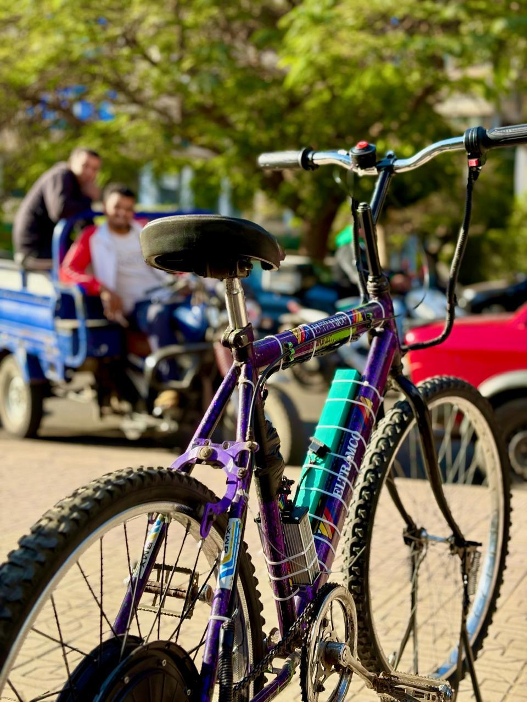

# Smart Cruise E-Bike

A regular bicycle converted into an electric bike, with a **PID cruise control** system built on ESP32.

Made for the **IEEE IES Hubs & Nodes Africa Competition** (Arab Republic of Egypt Qualifier).
Egyptian Chinese University, Faculty of Engineering and Technology, Energy and Renewable Energy Engineering Department.



## What is this project?

We converted a bicycle into an e-bike using a 450 W hub motor.
Then we added a smart cruise control.

The rider reaches a speed with the throttle and presses the cruise button.
The ESP32 then holds that speed by itself. No need to keep twisting the throttle.

## Main features

- 450 W BLDC hub motor on the rear wheel, 48 V Li-ion battery (10 Ah)
- Closed-loop PID cruise control on ESP32
- Relay switches between manual throttle and cruise control
- Brake cut-off: braking stops the motor, resets the PID, and gives control back to the throttle
- Low cost and easy to build

## How the cruise control works

1. The rider reaches the desired speed with the manual throttle.
2. The rider presses the cruise button.
3. The ESP32 saves the current speed as the set-point and flips the relay from NC to NO.
4. The X9C103S digital potentiometer now sends the throttle signal to the motor controller.
5. The digital speedometer sends the real speed back to the ESP32.
6. The PID calculates the error (set-point minus actual speed) and moves the potentiometer up or down.
7. When the rider brakes, the motor is cut off, the PID resets, and the relay returns to NC.

```
Speedometer --> ESP32 (PID) --> X9C103S --> Relay (NO) --> Motor controller --> Hub motor
                   ^                                            ^
        Cruise button                          Manual throttle (NC, when cruise is OFF)
```

## Main components

| Component | Role |
|---|---|
| ESP32 | PID controller |
| X9C103S digital potentiometer (10 kΩ, 100 steps) | Replaces the throttle signal |
| XL7015 buck converter | Steps 48 V down to 5 V |
| 5V single-channel relay | Switches between manual throttle and cruise |
| Digital speedometer | Speed feedback to the ESP32 |
| 450 W BLDC hub motor + 48 V controller | Drive system |
| 48 V / 10 Ah Li-ion battery | Power source |

Full details and wiring are in [hardware/README.md](hardware/README.md).

## Results

- Smooth acceleration up to 25 to 30 km/h
- Estimated range of 40 to 50 km per charge
- Cruise control tested: it holds the set speed through the PID loop
- Brake cut-off tested: it disables the motor and returns manual control

## Secondary system: phone charging (design)

A bicycle dynamo (12 V AC, 6 W) with a KBP206 bridge rectifier, a 1000 µF capacitor, and an LM2596 buck converter gives 5 V to a USB-C socket.
In the report this is described as a design that can charge a phone. Pedal-powered generation is listed as future work.

## Repository structure

```
smart-cruise-ebike/
├── README.md          <- you are here
├── hardware/          <- components and wiring
├── firmware/          <- ESP32 code (Arduino)
├── docs/              <- full project report (PDF)
└── media/             <- photos and videos
```

## Documentation

- Full report: [docs/Smart_Cruise_E-Bike_Project_Report.pdf](docs/Smart_Cruise_E-Bike_Project_Report.pdf)
- Hardware and wiring: [hardware/README.md](hardware/README.md)
- ESP32 code: [firmware/README.md](firmware/README.md)

## Future work

- Fine-tune the PID gains (Kp, Ki, Kd) for different terrain and loads
- Add a screen for speed and battery level
- ESP32 Bluetooth for remote parameter tuning
- Pedal-powered generation for phone charging

## Team

- Peter Ramez Nashaat
- Hussein Mohamed Lutfy
- Philopateer George Fayez

Supervisor: Assoc. Prof. Hady Habib Fayek

## License

MIT License. See [LICENSE](LICENSE).
